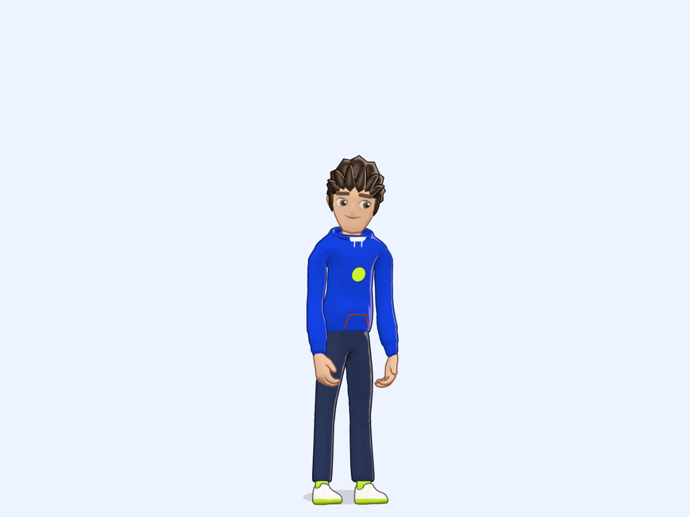

# Buddy

An animated 3D companion for HTML presentations. Buddy walks around, reads your
slides, climbs onto cards and performs tricks. He grows bolder as your talk
progresses. Movement, reactions and powers are on by default.



## Add Buddy to a presentation

Download the [web ZIP from the latest release](https://github.com/tonyprots/buddy-library/releases/latest).
It includes the ready-to-use script, examples and documentation.

1. Put `buddy.js` next to your HTML file. You can also download
   [dist/buddy.js](dist/buddy.js) directly using **Download raw**.
2. Add one line:

   ```html
   <script defer src="./buddy.js" data-stage="#stage"></script>
   ```

3. Open your presentation. No server, npm, build step or network connection
   required. Try the [quick-start deck](examples/quick-start.html) by double-clicking it.

Your stage needs `position: relative`, a logical size of **1280×720**, and
`overflow: hidden`. By default, its direct `.slide` children are slides and
`on` marks the active one. Your presentation controls navigation and visibility;
Buddy watches the active class.

Different markup? Point Buddy at your existing slides:

```html
<script defer src="./buddy.js" data-stage="#deck"
  data-slide-selector=".pages > article" data-active-class="is-active"></script>
```

Scale the entire stage with `transform: scale(k)` to fit the viewport.
Arbitrary slide dimensions, scrolling pages and rotated stages are not supported.
For reveal.js and similar engines, configure a 1280×720 stage and select only
leaf slides. Buddy is not a universal presentation-engine plugin.

## Ask your coding agent

> Read the [integration guide](docs/agent-integration.md) and add Buddy to my
> HTML presentation. Keep its navigation, design and Buddy's active defaults.

The guide and API reference are enough. Consumers do not need to install
development tools or run the library's test suite.

## Match your presentation's brand

Use the logo, product images and accent color from your presentation:

```html
<script type="application/json" id="deck-brand">
{"logo":"./logo.svg","products":["./product-a.svg","./product-b.svg"],"accent":"#267052"}
</script>
<script defer src="./buddy.js" data-stage="#stage" data-brand="#deck-brand"></script>
```

Brand actions turn on automatically when images are supplied. A single logo
works too. Without a brand, Buddy keeps his usual behavior.
Try [Leaf Lab, a fictional brand](examples/brand.html).
Use local images or data URIs for offline presentations.

## What you get

- 93 actions: gestures, acrobatics, props, powers and stories based on slide content.
- Active `show` mode, a `curious` personality and increasing confidence toward the finale.
- Bundled Three.js and character model, with no external dependencies to load.
- An SVG fallback without WebGL and a still character when reduced motion is enabled.
- Pause controls, manual actions, scripted sequences and TypeScript declarations.
- English UI and documentation; English and Russian slide-content recognition.

After the script loads, `await window.buddy` gives you the instance. Add an
accessible pause button using `pause()` / `resume()`. Call `destroy()` when
removing the stage.

## Documentation

- [API reference](docs/api.md): ESM, bundlers, modes, scenes and limitations.
- [Integration guide for coding agents](docs/agent-integration.md).
- [Slide context](docs/slide-context.md) and [automatic reactions](docs/slide-reactions.md).
- [Contributing](CONTRIBUTING.md): only needed when changing the library itself.
- [Changelog](CHANGELOG.md).

The package is not on npm yet. For a project with a bundler, install the TGZ
from the release or a downloaded source folder:

```bash
npm install ../buddy-library
```

## Licenses

Library code: [MIT](LICENSE). Three.js: MIT. Quaternius model: CC0.
Keep [third-party notices](THIRD_PARTY_NOTICES.md) alongside the script.
Yandex 360 is an optional example in the source distribution. Its images live
in `dist/buddy-y360.js`, separate from the main bundle and the web ZIP.
Trademark rights remain with their respective owners.
