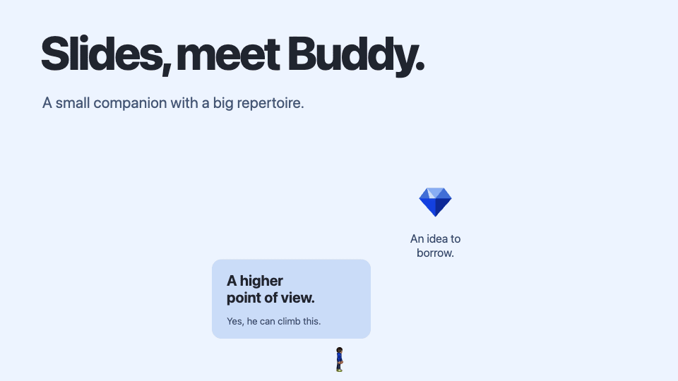

<div align="center">

# Buddy

### Make your presentation impossible to ignore.

An animated 3D companion for HTML presentations.<br>
More variety on every slide. A little mischief. All eyes on your deck.

[**Get Buddy**](https://github.com/tonyprots/buddy-library/releases/latest) · [**Add to your slides**](#one-script-and-hes-in) · [**Guide for coding agents**](docs/agent-integration.md)



<sub>Real library. Real slide content. Edited excerpts from the <a href="examples/showcase.html">scripted showcase</a>, with close-ups.</sub>

</div>

## Your content. His playground.

A card becomes somewhere to climb. An image becomes something to borrow.
A quiet opening builds into a more adventurous finale. Buddy gives your
presentation a character the audience can follow, with **93 actions** spanning
gestures, acrobatics, props, powers and stories built around your slides.

- **Give every slide a little surprise.** Buddy walks, climbs and interacts with actual content, including text, images and diagrams.
- **Build toward the big finish.** Active `show` mode and a `curious` personality are on by default. He grows bolder as the presentation progresses.
- **Make him part of your world.** Bring your logo, product images and accent color into his outfit and tricks.
- **Keep presenting your way.** One local script. Your slide navigation. No account, server, build step or internet connection needed.

## One script, and he's in.

Download the **web ZIP** from the [latest release](https://github.com/tonyprots/buddy-library/releases/latest),
put `buddy.js` next to your presentation and add:

```html
<script defer src="./buddy.js" data-stage="#stage"></script>
```

Open your HTML file. Buddy is already active.

Starting fresh? Double-click **`examples/quick-start.html`** in the ZIP for a
working three-slide deck. Open **`examples/showcase.html`** to watch the full
climb-and-magnet sequence, with replay and pause controls.

Your deck needs a positioned **1280×720** stage, `.slide` children and an `on`
class on the active slide. Scale the whole stage to fit the screen.
Different markup? [Point Buddy at your existing slides](docs/agent-integration.md).
You can also download [dist/buddy.js](dist/buddy.js) using **Download raw**.

<details>
<summary><strong>Let your coding agent handle the integration</strong></summary>

Paste this into your agent, along with the downloaded library:

> Read Buddy's `docs/agent-integration.md` and add Buddy to my HTML presentation.
> Preserve its navigation and design. Keep the active defaults, connect slide
> progress, and add a pause control. Use the existing brand assets if available.
> Verify the result with a light browser check.

The [agent guide](docs/agent-integration.md) covers stage sizing, custom selectors,
brand assets and lifecycle. No development tools or library test suite required
for integration.

</details>

## Your brand gets to play, too.

A logo in his energy ball. Your product images orbiting a shield.
An accent color that ties his hoodie and effects to your slides.

```html
<script type="application/json" id="deck-brand">
{"logo":"./logo.svg","products":["./product.svg"],"accent":"#267052"}
</script>
<script defer src="./buddy.js" data-stage="#stage" data-brand="#deck-brand"></script>
```

Brand actions switch on when you supply images. One logo is enough to start.
See the [Leaf Lab example](examples/brand.html); use local images for offline decks.

## Let him improvise. Or direct the moment.

Automatic behavior works out of the box. For a planned reveal, use a scripted
sequence and wait for the whole performance to finish:

```js
const buddy = await window.buddy;
await buddy.story(['wave', { wait: 0.5 }, 'bow']).finished;
```

Add pause/resume controls, choose a personality, trigger an action or build a
sequence around your slide content. The [API reference](docs/api.md) covers
manual control, ESM, TypeScript and bundlers.

<details>
<summary><strong>Compatibility and considerate motion</strong></summary>

- Designed for HTML decks with a logical **1280×720** stage and uniform CSS scaling.
- Custom slide selectors and active classes are supported. For engines such as reveal.js, adapt the stage and select leaf slides; there is no dedicated engine plugin.
- Scrolling pages, arbitrary logical dimensions and rotated stages are not supported.
- Three.js and the character model are bundled. WebGL gives the full 3D experience; an SVG character is used when WebGL is unavailable.
- `prefers-reduced-motion` keeps the character still. Add an accessible pause control with `pause()` / `resume()`; call `destroy()` when removing a stage.
- English UI and docs; English and Russian slide-content recognition.
- Not on npm yet. Bundler projects can install the release TGZ or a downloaded source folder.

</details>

## Keep exploring

| I want to… | Start here |
| --- | --- |
| Add Buddy to an existing deck | [Integration guide](docs/agent-integration.md) |
| Control actions and sequences | [API reference](docs/api.md) |
| Use slide content in the performance | [Slide context](docs/slide-context.md) · [Automatic reactions](docs/slide-reactions.md) |
| Browse the full repertoire | Open `index.html` from the source ZIP |
| Change the library itself | [Contributing](CONTRIBUTING.md) · [Changelog](CHANGELOG.md) |

---

**Free and open source.** Library and Three.js: MIT. Character model: Quaternius, CC0.
Keep [third-party notices](THIRD_PARTY_NOTICES.md) alongside the script.
Optional Yandex 360 example assets ship separately; trademark rights stay with their owners.
